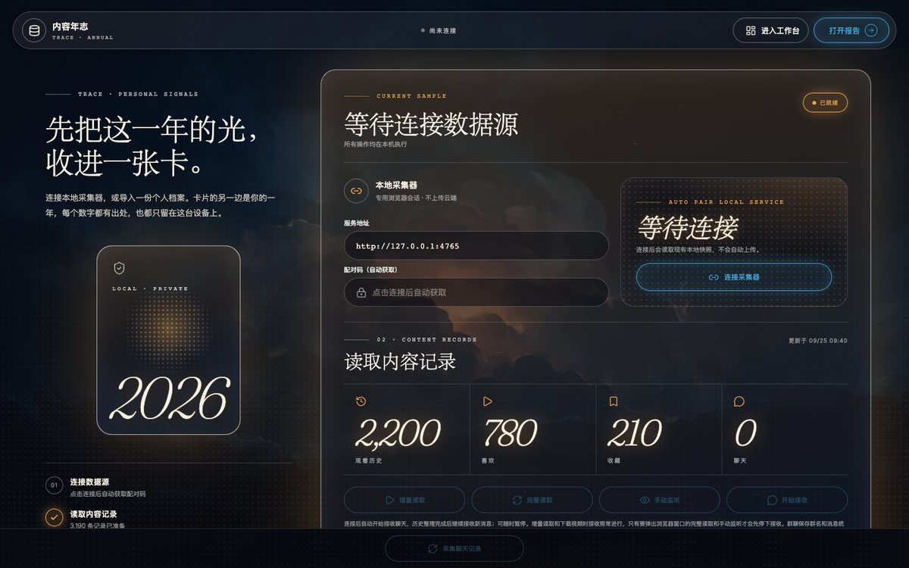
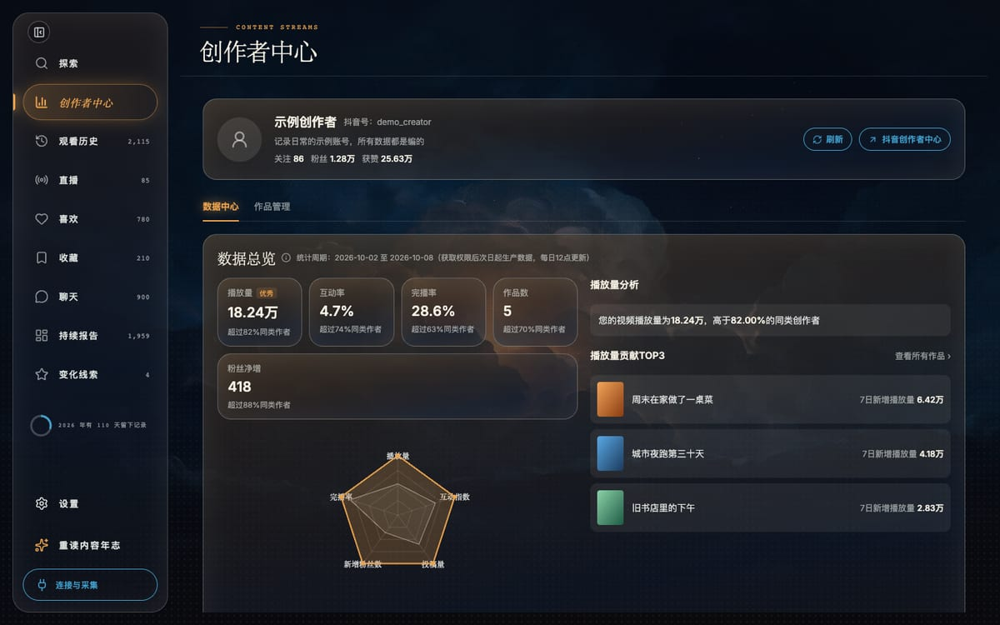
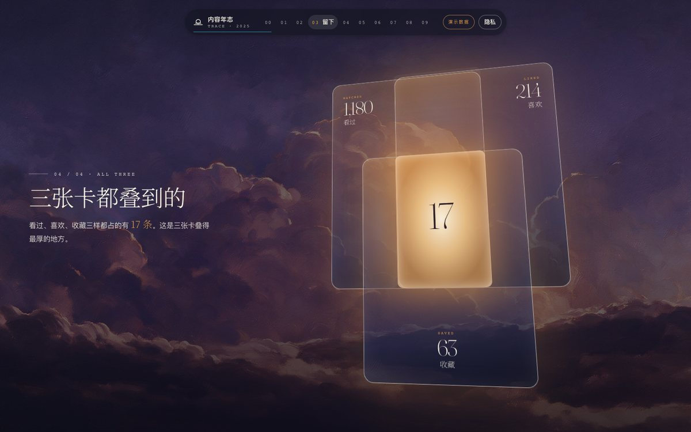
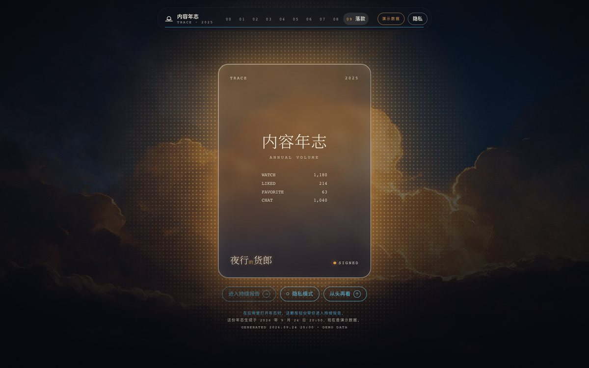
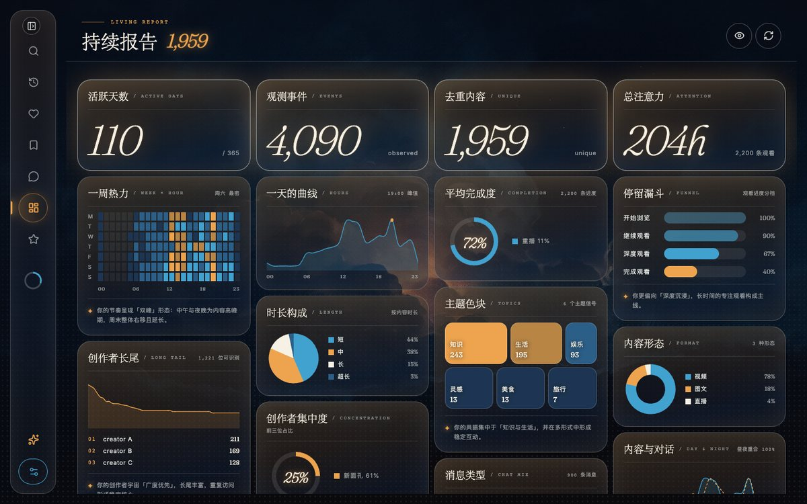
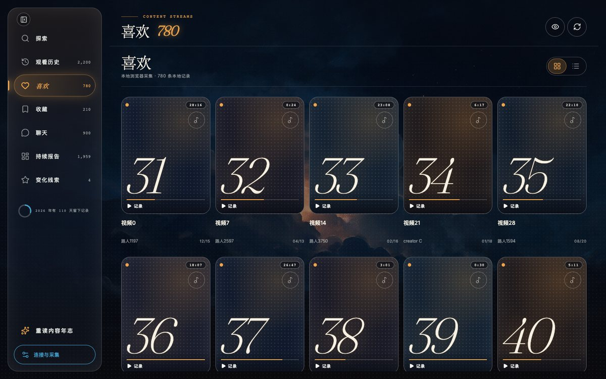
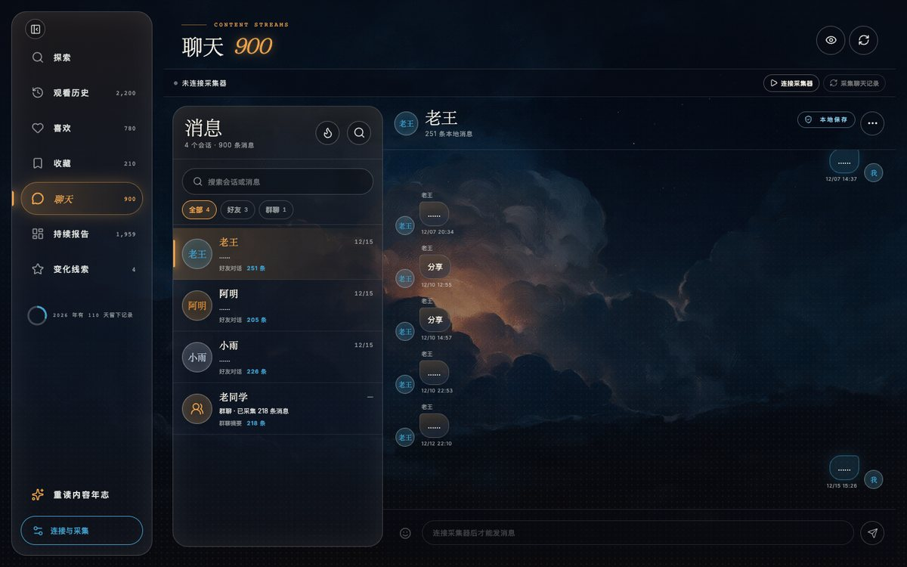
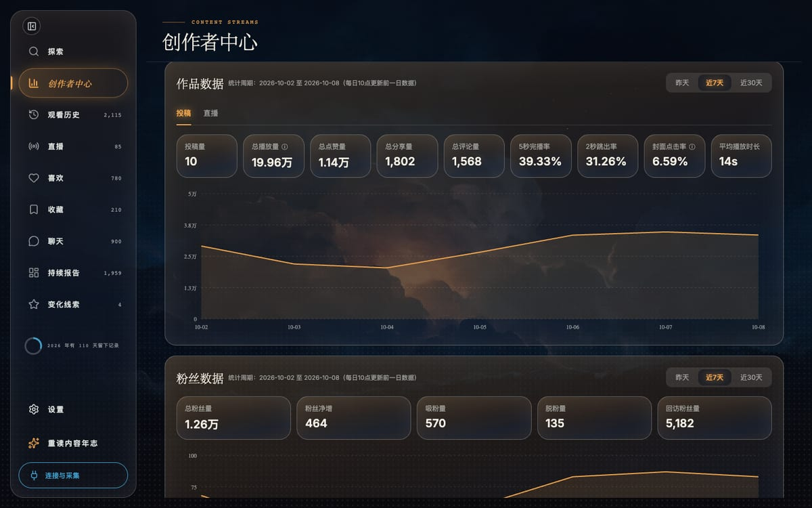
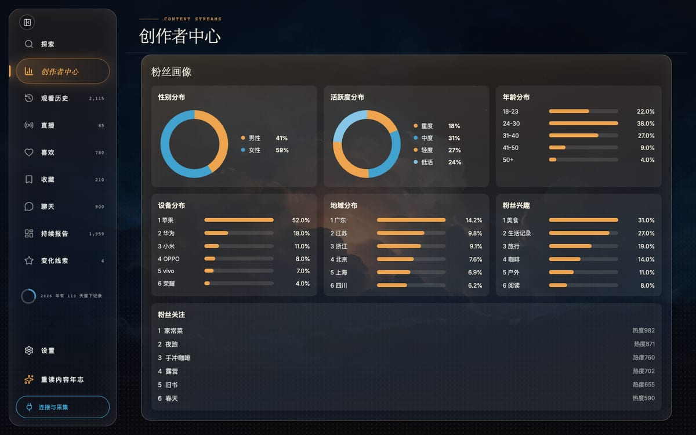

<div align="center">
  <a href="https://github.com/ZhangYukwiver/DouyinDataReview/releases/latest"></a>
  <h1>DouyinDataReview | 抖音数据导出与年度报告工作台</h1>
  <p><strong>把你的抖音数据，留在自己的电脑上</strong></p>
  <p>导出观看历史与聊天记录，管理喜欢和收藏，批量下载视频，生成自己的抖音年度回顾。<br>
  免费开源 · Windows / macOS · 本地保存 · MIT 许可</p>
  <p>问题反馈与交流请联系 QQ 940537208，或加入 QQ 群 DDDouyin（群号 1124211302），见<a href="#交流与反馈">交流与反馈</a>。</p>
  <p>
    <a href="https://github.com/ZhangYukwiver/DouyinDataReview/releases/latest"></a>
    <a href="https://github.com/ZhangYukwiver/DouyinDataReview/blob/main/LICENSE"></a>
    <a href="https://github.com/ZhangYukwiver/DouyinDataReview/actions/workflows/desktop-release.yml"></a>
    <a href="https://github.com/ZhangYukwiver/DouyinDataReview/stargazers"></a>
    <a href="https://github.com/ZhangYukwiver/DouyinDataReview/releases"></a>
    <a href="https://github.com/ZhangYukwiver/DouyinDataReview/network/members"></a>
    <a href="#交流与反馈"></a>
  </p>
</div>

<table>
  <tr><td></td><td></td></tr>
</table>

<p align="center"><sub>连接与采集、创作者中心。截图都是合成示例数据。</sub></p>

<p align="center"><a href="https://github.com/ZhangYukwiver/DouyinDataReview/releases/latest">下载桌面版</a> · <a href="https://zhangyukwiver.github.io/DouyinDataReview/">国内下载（加速线路）</a> · <a href="https://zhangyukwiver.github.io/DouyinDataReview/#demo">在线看示例报告</a> · <a href="#面向开发者">从源码运行</a> · <a href="https://github.com/ZhangYukwiver/DouyinDataReview/stargazers">觉得有用就 Star</a></p>

**DouyinDataReview 是一款免费开源的抖音数据采集、导出与分析桌面应用。** 它通过本人登录账号的会话读取抖音观看历史、喜欢、收藏和好友聊天记录，在本机保存为 JSON，并生成持续报告与抖音年度报告（Douyin Wrapped）。工作台还提供视频下载、实时聊天、内容搜索、创作者中心、热点榜和直播观看；可选 AI 视频解析与 AI 剪辑可使用你配置的大模型接口，或本机已登录的 Codex / Claude Code。

适合备份个人抖音记录、管理收藏内容、查看创作者数据，以及制作自己的年度回顾。项目面向抖音（Douyin，中国版），不支持国际版 TikTok；提供 Windows x64 和 macOS Apple Silicon 安装包。它是独立开发的非官方工具，与抖音、字节跳动及其关联主体不存在隶属、授权、合作或认可关系。

| 先了解什么 | 简要说明 |
| --- | --- |
| 如何导出数据 | 首屏扫码并确认读取权限，在「设置 → 数据」勾选导出 JSON；聊天默认不勾选，备份不含群聊正文 |
| 是否能取回全部历史 | 只能读取本人账号当前可访问的接口记录；不保证完整历史，也不会补造报告中的缺失数据 |
| 是否必须用 AI | 本地统计与年度报告不需要 AI；可选解析和剪辑通过自配接口或本机 CLI 访问 AI 服务，使用自己的订阅或服务商计费 |
| 是否能离线导入 | 支持本应用备份与抖音官方 JSON / ZIP 档案；官方档案导入关闭后需重新选择文件 |

[数据导出与年度报告使用指南](https://zhangyukwiver.github.io/DouyinDataReview/guide.html)提供完整步骤、数据覆盖范围和 AI 数据流；供检索工具读取的[项目事实与文档索引](llms.txt)与下载页问答同步维护。

**阅读导航：** [主要功能](#主要功能) · [实现方式](#实现方式) · [快速开始](#快速开始) · [本地数据与接口](#本地数据与接口) · [常见问题](#常见问题) · [面向开发者](#面向开发者)

> [!NOTE]
> 桌面版打开就在首屏扫抖音的登录二维码，不用打开浏览器调试、也不用手动连接采集器；也可以从 Chrome 144+、提供远程调试开关的 Edge 或 macOS Comet 导入登录凭据。导入成功后自动断开；凭据失效后重新扫码或连接并导入。无需安装扩展。工具读取本人账号在平台接口当前可访问的记录，不能保证取回全部历史数据；采集使用抖音未公开承诺的私有接口，可能失效或触发账号风控。

## 主要功能

| 功能 | 可以做什么 | 使用条件与边界 |
| --- | --- | --- |
| 抖音数据采集与导出 | 完整或增量读取观看历史、喜欢和收藏，保存好友聊天记录，导出 JSON；支持导入本应用备份和抖音官方个人信息下载的 JSON / ZIP | 在线采集需要导入本人登录凭据；官方档案可离线导入；群聊正文不写入备份 |
| 多账号与后台补读 | 各账号分别保存登录会话和个人记录；前台自动补读，桌面版关闭窗口后留在托盘或菜单栏，每 3 小时补读一次，可选开机后台运行 | 凭据需保持有效；在设置中控制自动补读 |
| 内容库与视频下载 | 按标题、作者、话题、音乐搜索本地记录；应用内播放、读评论、发评论和转发；单条下载或多选打包 ZIP，图文作品下载全部图片 | 在线播放、评论和下载需要网络及有效会话；观看过的直播单独展示 |
| 实时聊天与续火花 | 接收新消息，回复好友与群聊，查看在线状态和官方火花天数；给勾选对象一键发送续火花消息 | 发送由用户主动触发；发送成功不代表火花天数增加，以抖音官方状态为准 |
| 创作者中心 | 查看本人账号的数据总览、作品数据、粉丝数据与画像，以及作品流量、观众和评论分析 | 读取抖音创作者中心接口，按当前账号权限返回数据；只读 |
| 内容探索与抖音指数 | 搜索用户和作品，点赞、收藏、关注、评论；下载用户主页作品；查看实时热点、飙升热点，以及达人指标、逐日趋势、近 30 天作品和粉丝画像 | 复用当前账号会话；达人指标与画像来自官方接口，显示范围受接口权限影响 |
| AI 视频工作台 · 解析（可选） | 拆解视频选题、开头钩子、内容结构、画面声音和可复用拍法，并说明每段画面为什么这样拍（场景、人物站位、对话、动作的用意）；解析结果保存到可搜索的解析库 | 和 AI 剪辑同属可选的「AI 视频工作台」，安装时或在设置中安装、移除；自备 OpenAI 兼容接口、模型和 API Key（和 AI 剪辑设置「服务商」里的「解析视频」是同一份，没单独填时直接用 AI 剪辑的剪辑模型）；支持视频输入时发送选中视频，否则发送本机提取的镜头截图和音乐节拍，此时听不到台词；也可以直接用这台电脑上登录好的 Codex 或 Claude Code（走自己的订阅，看不了视频，改看应用拆出的截图和节拍） |
| AI 视频工作台 · 剪辑（可选） | 页面照剪辑软件排：左边和 AI 对话、翻素材，中间是播放器，右边是属性面板，底下是整条时间线，AI 剪的每一步都实时出现在上面；AI 按你的要求剪切拼接、配字幕和文字（视频里有人说话的，AI 能听一遍把台词转写成字幕；要用接口模式下能看视频、听得到声音的模型，比如方舟 doubao-seed-2-1-lite，本机 Codex、Claude Code 和只看画面的模型转写不了），加特效、滤镜、转场、动画、关键帧和背景音乐，做好后一键导入剪映草稿箱继续精修。素材里没有的画面，AI 还能现做：图片用 OpenAI 兼容的图片接口生成，视频片段可以用火山方舟 Seedance、即梦、小云雀或 LibTV 生成，做好直接进素材库；生成视频前会先在页面上问你，你点了「生成」才开始，开始以后就停不下来了：点了停止或等太久，视频也会在后台做完放进素材库、照常扣费（应用要开着）。时间线和画面上也能自己动手：拖动、裁剪、切开、复制、跨轨道挪片段，在画面上直接挪位置、缩放、旋转、改字；时间线工具栏配了分割刀、标记、主轨磁吸（主轨上删、挪、裁时后面的自动跟上）、吸附、联动（字幕、画中画跟着主轨片段走）、预览轴（鼠标划过时间线，画面跟着看）和字幕显示开关，也能直接往字幕里补一句；每一步都能撤销重做，也能退回到某句话之前；在画面上框一块，让 AI 只改框里的东西；片段、某一刻和素材可以直接引用到对话，截图能贴进对话给看得了图的模型看，AI 回复里提到的片段和时间点一点就跳过去；再次导入前会检查剪映里那份草稿有没有被打开或改过，由你选另存一份还是覆盖。剪映内置做不出的画面（标题字卡、动态大字、数据图表、倒计时），AI 可以写成网页片段，看板上实时预览，导入剪映时自动渲成视频（带透明的叠在画面上）；不经剪映也能直接导出 MP4，或者导出、导入网页工程（film.html 打成的 zip）。还能装技能（带 SKILL.md 的技能包，填 GitHub 地址或选本机文件夹）：AI 照技能里的说明读写技能文件、在这台电脑上跑命令，把做出来的音频、图片、视频放进素材库；每条命令先在页面上问你，点了「运行」才跑，也可以给某个技能勾上以后不用问 | 自备支持工具调用的 OpenAI 兼容接口（默认火山方舟），或者用这台电脑上登录好的 Codex、Claude Code，和视频解析分开配置；素材来自内容库或本机文件；生成图片和视频都要在 AI 剪辑设置的「服务商」里连上：图片填 OpenAI 兼容图片接口的 Key；视频连方舟（填 Key 或勾选借用已经填的方舟 Key，Seedance 要先在方舟控制台开通）、即梦、小云雀或 LibTV（这三家都用这台电脑上登录好的官方命令行：dreamina、pippit-tool-cli、libtv，不填 Key），再在「生成素材」里选用哪家；图片接口和方舟地址能换成中转站，都按服务商计费；导入前需退出剪映，macOS 版剪映 11.6 已实测 |
| 直播观看与弹幕 | 查看正在直播的关注列表，在应用内观看直播；调整弹幕透明度、字号、速度、区域和屏蔽词 | 只观看和接收，不发弹幕、不送礼物、不点赞 |
| 持续报告与抖音年度报告 | 比较最近 30 天与上一时段，样本不足时回退到 90 天；年度回顾提供内容年志、档案馆、海报，可导出独立 HTML 和 1080 × 1440 PNG 分享图 | 基于本机已保存的记录生成；展示数据覆盖情况，不补造缺失记录 |

界面默认使用白底细线的极简风格。「设置」集中管理界面风格、自动补读、隐私模式、账号、数据导出与清除、可选功能和应用更新。

## 实现方式

DouyinDataReview 由 **React / React Native / Expo 工作台、Node.js 本地采集器和 Electron 桌面壳**组成。桌面版在本机启动采集器与静态页面服务；从源码运行时，也可以在浏览器中打开同一套工作台。

### 登录、采集与本地报告的数据流

1. **导入登录凭据**：桌面版在一个不显示的应用内窗口里打开抖音网页（`desktop/inAppBrowser.mjs`，独立会话，只通过窗口自己的调试通道读取，不开调试端口），把登录框的二维码搬到采集器页首屏给本人扫；也可以在 Chrome、Edge、macOS Comet（Playwright 的 CDP 连接）里登录。采集器核对账号、本人确认后导出抖音 Cookie、请求参数和签名凭据，按账号保存，然后断开。
2. **请求平台接口**：采集器复用导入的会话发起 HTTP 请求，通过签名器生成所需请求签名。观看历史、喜欢和收藏按接口游标分页读取，完整读取与增量读取都不依赖网页滚动；聊天和直播弹幕通过 WebSocket 接收。
3. **保存个人记录**：接口返回的数据经过归一化和合并，写入当前账号的 `records.json`。观看事件保留重复观看的信息；喜欢和收藏按作品身份处理。记录文件与登录凭据分别保存。
4. **生成统计与报告**：工作台通过本地 API 读取记录，在本机计算时间分布、作者与话题排行、观看和收藏交集、聊天统计等，再把汇总快照交给年度回顾页面。报告生成不需要外部 AI 服务。

导入凭据时分别勾选「读取视频」和「读取聊天」，至少选择一项。勾选视频后自动读取观看历史、喜欢和收藏（新账号整份读取，已读完过的账号重新导入只补新增），不受「自动补读新记录」开关影响；勾选聊天后自动整理聊天历史并开始接收。未开启的类型不能继续联网读取，已有本地数据仍可查看和导出。选择按账号保存，重启和切换账号后继续生效，重新导入凭据可调整；旧版导入的账号保持原有两项能力。重启后会复用本机缓存并核对平台返回的账号，凭据缺失或失效时由本人重新登录、验证并导入。

### 功能模块与源码入口

| 模块 | 实现方式 | 主要源码 |
| --- | --- | --- |
| 工作台与桌面运行 | React 组件展示数据；Expo 提供 Web 构建；Electron 管理窗口、托盘、后台补读和应用更新 | [工作台组件](src/components/workspace/)、[桌面入口](desktop/main.mjs) |
| 浏览器凭据与请求会话 | Playwright 连接已授权的浏览器 CDP；导入后使用独立 HTTP 请求会话，不要求浏览器持续运行 | [浏览器连接](collector/browserConnection.mjs)、[采集流程](collector/douyinCollector.mjs)、[HTTP 客户端](collector/directApi.mjs) |
| 记录采集与存储 | 签名请求与游标分页，归一化字段、合并记录，按账号写入 JSON | [分页与签名](collector/directHistory.mjs)、[归一化](collector/normalizer.mjs)、[记录存储](collector/store.mjs)、[账号管理](collector/accounts.mjs) |
| 搜索与互动 | HTTP 查询用户、作品和评论；用户触发点赞、收藏、关注、评论等写入，消息和分享通过 IM 接口发送 | [内容探索](collector/directExplorer.mjs)、[互动请求](collector/directWrites.mjs) |
| 聊天与直播 | HTTP 获取历史与房间信息；`ws` 接收 WebSocket 推送，解析二进制协议；直播弹幕仅在内存保留最近 300 条 | [聊天客户端](collector/directChat.mjs)、[直播客户端](collector/directLive.mjs)、[协议解析](collector/directProto.mjs) |
| 创作者与达人数据 | 通过当前账号会话读取创作者中心和抖音指数接口，整理指标与图表 | [创作者中心](collector/creatorCenter.mjs)、[抖音指数服务](src/services/douyinIndex.ts) |
| 视频播放与下载 | HTTP 获取作品详情和媒体地址，由本地接口提供播放与下载；批量视频通过 `fflate` 打包 ZIP | [媒体下载](collector/videoDownloader.mjs)、[批量打包](src/services/batchVideoDownload.ts) |
| AI 视频解析 | 读取选中视频，以视频、公开作品资料和提示词请求用户配置的 OpenAI 兼容接口，结果存入本地 `analyses.json` | [解析服务](collector/videoAnalysis.mjs)、[前端调用](src/services/videoAnalysis.ts) |
| AI 剪辑 | 采集器带着工具定义请求用户配置的 OpenAI 兼容接口，按模型的工具调用编辑时间线；选本机 Codex / Claude Code 时，采集器起一个不落盘、关掉自带命令行和文件工具的 CLI 进程，剪辑工具经一个只在本机、每轮随机密钥的 MCP 端点交给它；工程编辑、剪映草稿生成和草稿箱写入移植自 [JianYingAPI](https://github.com/ZhangYukwiver/JianYingAPI) 与 pyJianYingDraft（Apache-2.0），用 Node 实现，不需要 Python 和 ffprobe。网页片段、film.html 的读写和播放用的是一个第三方开源项目（MIT，许可证见 `collector/licenses/`）的 film-doc、timeline 和宿主约定；逐帧渲染在桌面版里用应用自己的隐藏窗口（单独跑采集器时用本机 Chrome / Edge），编码和混音用浏览器自带的 WebCodecs，装进 MP4 / MOV 也是自己写的，不带 ffmpeg。生成图片走 OpenAI 兼容的图片接口，生成视频走选用的那家（方舟 Seedance 的接口，或本机的即梦、小云雀、LibTV 命令行）的异步任务（先建任务，再等它做完），结果都下载进素材库 | [剪辑服务](collector/aiEdit/)、[网页片段与 film.html](collector/aiEdit/film/)、[剪辑页面](src/components/workspace/AiEditWorkspace.tsx)、[剪辑看板](src/components/workspace/AiEditBoard.tsx) |
| 报告与档案导入 | TypeScript 计算年度与持续报告，标注日期来源和覆盖率；解析本应用备份及官方 JSON / ZIP；年度页面导出 HTML 与 PNG | [年度统计](src/domain/annualReport.ts)、[持续报告](src/domain/livingReport.ts)、[档案解析](src/domain/personalArchiveParser.ts)、[汇总快照](src/services/storyData.ts)、[报告导出](prototype/story-export.js) |

### 数据来源与功能边界

个人记录来自本人账号可访问的抖音接口，或本人导入的官方档案；创作者指标、达人指标和火花状态来自对应平台接口。报告只能反映已采集的数据：缺失日期、缺失字段和样本不足会影响统计，应用不会把采集时间当成真实观看时间。

AI 剪辑对话时，你的消息、素材清单（名称、时长、尺寸，从内容库添加的还带作者）和当前时间线会发送到 AI 剪辑配置的接口；你在看板上手动做的改动、撤销和退回，以及在画面上框选的范围和框里的片段、你引用的片段、时刻和素材，会附在你的下一句话前面一起发送；素材文件本身不上传，例外是贴进对话的图片（发一份长边不超过 1024 的压缩预览，只带最近两条贴图消息里的，模型看不了图时只发图片名）、让 AI 解析参考视频、让 AI 转写字幕和让 AI 生成图片、视频（都见下）。对话太长时，较早几轮的工具细节会压缩或省略，被省略的那几轮里你说过的话（每条前 200 字，合计不超过 3000 字）仍会附上一起发送。AI 在内容库里找视频时，会把匹配到的作品标题、作者、话题、时长和链接，连同你点赞、收藏或观看它的日期、它在哪个列表里，一起发给该接口；不带关键词找时，发的是最近的最多 30 条。这些结果会留在这次剪辑的对话记录里，后面几轮对话也会再发送。让 AI 参考抖音上的同款时，搜索词会用你的抖音登录发给抖音，搜到的作品标题、作者、点赞数、时长和链接发给 AI 剪辑的接口；解析参考视频时，视频文件（抖音链接下最低一档清晰度，素材库里的视频直接用原文件）发到「解析视频」的接口（和 AI 解析是同一份设置，没单独设置时就是 AI 剪辑配置的接口）；让 AI 把时间线上视频里的台词转写成字幕时，那条素材的视频文件同样发到这个接口（超过 45MB 的先在本机压一份小的）；保存接口设置时会先发一段 3 秒的测试小视频，看这个模型能不能直接看视频。看不了的话，改由开着的应用页面在本机浏览器里把视频拆成镜头截图、镜头表和音乐节拍，只把这些发给该接口；让 AI 测配乐节拍时，同样只在本机浏览器里解码，不上传。参考视频的解析结果不进解析库。装了技能时，启用的技能的名字和说明、AI 读到的技能文件内容和技能命令的输出也会发到 AI 剪辑配置的接口；技能命令在这台电脑上运行，联不联网、往哪里发由技能自己决定，所以每条命令都先问你。让 AI 生成图片或视频时，AI 写的画面说明和拿来当参考的素材图片会发给你在 AI 剪辑设置里开启的生成服务：图片发到你配置的图片接口（默认 OpenAI），视频发到你在「生成素材」里选的那家（火山方舟 Seedance，或经这台电脑上登录好的命令行发给即梦、小云雀、LibTV），图片接口和方舟可以是中转站；视频做好后服务商给的是一个临时链接，应用拿到就立刻下载进素材库。生成服务的 Key 和其他 AI 设置一样存在这台设备的浏览器配置里，随请求交给本机采集器、只在请求里使用，采集器不写进剪辑记录。AI 写的网页片段只在本机渲染，网页里可以从 jsDelivr、cdnjs、unpkg、esm.sh 引脚本库，从 Google Fonts 引字体，渲染和预览时会请求这些地址；网页不能往别处发请求。

AI 视频解析与本地报告是两个独立功能。解析时，选中视频、公开作品资料和提示词会发送到用户配置的 AI 服务；如果配置的模型看不了视频（保存设置时用一段 3 秒的测试小视频测出来），改由开着的应用页面在本机浏览器里把视频拆成镜头截图和音乐节拍，只发这些，这时听不到台词和旁白。抖音 Cookie 和整份个人记录不发送给该服务。AI 的拆解属于模型生成内容，需要结合原视频判断。

## 年度回顾

在「设置」的「界面风格」里挑一种，再点「打开报告」。风格同时决定采集器页和工作台的样子；默认的极简风格只管这两页，没有单独的报告页，打开报告时用设置里选的一套。

- **内容年志**（默认）：先看到一张入口卡，写着观看、喜欢、收藏、聊天各有多少条；点卡片穿过去，是一卷十章的夜色长卷，天色随章节在五个时辰的油画之间变换。
- **档案馆**：暗色星图卷宗，按页展示记录与图表，支持点击和键盘翻页。
- **海报**：墨黑、新闻纸配信号橙的展览海报，十章硬切长卷，就是下面演示视频中的一种视觉风格。

https://github.com/user-attachments/assets/f4dd2420-121d-49b7-ba37-c632c03f10ec

<p align="center"><sub>海报风格的年度回顾，从封面一路滚到落款。视频和截图都是合成示例数据；这是可切换的其中一种视觉风格。</sub></p>

<table>
  <tr><td></td><td></td></tr>
  <tr><td></td><td></td></tr>
  <tr><td></td><td></td></tr>
</table>

> 报告只用记录里明确带着的作者、话题、音乐、时长和互动数，不接外部 AI 推测兴趣，也不做心理诊断。视频的「词条」只取显式话题标签；聊天高频词用浏览器内置的 `Intl.Segmenter` 分词，先剔除平台模板消息，群聊正文不参与。

<details>
<summary>工作台截图：连接与采集、持续报告、内容库、聊天、创作者中心（点击展开）</summary>

<table>
  <tr><td></td><td></td></tr>
  <tr><td></td><td></td></tr>
  <tr><td></td><td></td></tr>
</table>

连接与采集页点「连接采集器」会自动取配对码；内容库的卡片可以下载视频、在应用内播放；聊天页的新消息实时进来，列表头的火苗按钮打开续火花看板，群聊打开时从抖音接口现读消息；创作者中心里能看数据总览、作品数据、粉丝数据和粉丝画像，字段和抖音创作者中心网页一致。

</details>

## 支持平台与设备

| 平台 | 设备 / 架构 | 安装包 |
| --- | --- | --- |
| Windows | x64 | `DouyinDataReview-Setup-<version>.exe`（NSIS 安装器） |
| macOS | Apple Silicon（arm64） | `DouyinDataReview-<version>-arm64.dmg` |

两个安装包都没有开发者签名，首次打开的处理方式见下面「快速开始」。手机端通过同一局域网连接电脑上的采集器使用，见[面向开发者](#面向开发者)末尾的[手机连接](#手机连接)小节。

## 快速开始

1. 打开[最新 Release](https://github.com/ZhangYukwiver/DouyinDataReview/releases/latest)，按上表下载对应安装包。

   **macOS 首次打开前需在终端执行一次 `xattr -cr "/Applications/DouyinDataReview.app"`，否则会提示应用已损坏；Windows 可能出现 SmartScreen 提示，点「更多信息」，再点「仍要运行」。**

2. 启动「DouyinDataReview」。桌面版会在后台自动连上自带的采集器（从源码在浏览器里打开时点「连接采集器」，配对码自动获取），之后默认在前台自动读取新记录，也可以手动点「增量读取」。关掉窗口应用会留在托盘里接着每 3 小时读一次，要完全退出就在托盘图标的菜单里点「退出」。
3. 首次使用在首屏「数据来源」里点二维码位置的遮罩「点击显示二维码」（二维码已在后台备好，遮罩一点就消失），用抖音 App 扫码并在手机上确认，核对昵称，勾选读取视频、读取聊天后点「确认导入」，读取会自动开始，只读所选类型。也可以点「改用 Chrome / Edge / Comet 导入」。凭据失效或需要调整读取权限时重新登录并导入。
4. 进入内容库，在观看历史、喜欢、收藏、聊天和持续报告之间切换；在「设置」里换界面风格、选报告用哪一套，点「打开报告」看年度回顾。

### 在应用里登录（桌面版默认）

1. 打开应用，首屏「数据来源」就是「扫码登录抖音」。凭据还没导入时，应用已经在后台打开抖音网页、备好二维码，点二维码位置的遮罩，码当场亮出来（抖音大约一分钟换一张码，这里跟着换；等了 5 分钟还没登录会自动续上新的一轮）。打开抖音 App，点左上角的扫一扫，扫码后在手机上确认。可以随时点「取消」。
2. 用密码或手机验证码登录后，抖音可能要求「使用原设备扫码」的二次验证，这张验证码同样显示在首屏，用登着这个号的抖音 App 扫一下即可。抖音要求身份验证（接收短信验证码、验证登录密码、发送短信验证、滑块等，扫码时或导入时都可能）时，首屏换成「抖音要求身份验证」，后台的抖音窗口不会自己弹出来。如果抖音给了「接收短信验证码」，可以直接在首屏点「用短信验证码验证」，看到打码的手机号、点「获取验证码」，收到后自己把验证码填进首屏提交，应用只是替你交给后台的验证页面；其他方式（验证登录密码、发送短信验证、滑块等）点「用其他方式验证」在窗口里完成。完成后登录或导入接着走；关掉这个窗口只是把它藏起来。想用手机验证码登录时，点「在窗口里登录」把窗口打开，认出登录后窗口自动收起、切回工作台。已经登录过的号在首屏显示「已登录」，凭据失效或要调整读取权限时点「重新扫码登录」。设置 → 账号里只留一个「去扫码登录」按钮，回到首屏操作；在浏览器里打开的网页版仍在设置里连接浏览器。
3. 登录后核对昵称，勾选「读取视频」「读取聊天」，点「确认导入」。导出凭据时后台网页会打开个人主页初始化一次，完成后自动关闭。

后台网页用独立的会话（`persist:douyin-login`），不和工作台页面共用 Cookie；网页标识是同版本的 Chrome，不带应用名；只允许打开抖音及其登录相关的页面，拒绝通知、摄像头等权限请求和文件下载。网页登录状态留在本机，凭据失效后再点「扫码登录」通常会直接认出原来的号，不用重新扫码。要添加另一个号时，在认出的账号下面点「换个号扫码」：应用清掉后台网页里的登录状态（只删本机这份 Cookie 和网页存储，不在抖音退出，已导入账号的凭据照常可用），再显示新的二维码。

### 导入已有浏览器登录凭据

1. 在「设置 → 账号 → 导入登录凭据」选择 Chrome、Edge 或 macOS Comet，点击「连接浏览器」。尚未开启远程调试时，工作台会尝试自动打开所选浏览器的调试设置页；本人勾选允许远程调试后，再次点击「连接浏览器」。自动打开失败时，在对应浏览器中手动访问 `chrome://inspect/#remote-debugging`、`edge://inspect/#remote-debugging` 或 `comet://inspect/#remote-debugging`。浏览器弹出确认框时，由本人允许连接。
2. 如果尚未登录抖音，在工作台新开的抖音页面完成登录。工作台会尝试打开登录框；未弹出时点击页面上的「登录」。连接最多等待 5 分钟，期间可点击「取消连接」。
3. 核对工作台显示的抖音昵称，分别勾选「读取视频」和「读取聊天」，点击「确认导入」。首次默认仅勾选视频，重新导入会带回该账号保存的选择。应用导出凭据后自动断开 CDP；勾选视频时自动读取观看历史、喜欢和收藏（首次整份读取，重新导入只补新增），勾选聊天时整理历史并开始接收。随后可关闭调试开关及浏览器。已有账号复用自己的记录目录，其他账号单独保存；取消或导入失败不会触发读取。

Chrome 的现有实例连接方式需要 144 或更新版本；Edge 需要提供远程调试开关的版本。工作台自动检测默认安装的稳定版用户目录和有效本机调试端口，并核对监听进程属于该浏览器，避免旧端口文件接到另一个实例；自定义用户目录、其他浏览器渠道和 Firefox 暂不支持此入口。无需安装浏览器扩展，也无需手填端口。

远程调试授权覆盖整个浏览器实例；工作台只读取抖音域 Cookie，并仅在自己创建的抖音标签页初始化凭据，不清理日常浏览器缓存、不修改原有标签页。断开连接、切换账号或退出应用会清理这些标签页并断开调试连接，浏览器进程继续保留，调试开关由本人关闭。接口读取和实时接收使用已导入的凭据，重启后会复用本机缓存并核对平台返回的账号；短期令牌过期本身不会要求重新导入。凭据缺失或不完整、平台拒绝登录、账号不一致或要求验证时，工作台才提示重新连接并导入。凭据有效期由抖音控制，不保证固定时长。

> 安装包只含应用代码、Web 页面和已校验的签名器，不含本地记录、登录状态或浏览器配置。采集记录保存在 macOS 的 `~/Library/Application Support/内容数据工作台/collector/` 或 Windows 当前用户的应用数据目录，改名后继续沿用，升级不会覆盖。旧版 macOS 应用名为「内容数据工作台」，替换时移除旧应用即可。
>
> 桌面版启动后会检查 GitHub Release。Windows 可在「设置」里下载并「重启并安装」，采集进行中不会自动重启；macOS 使用设置里的下载入口，手动替换应用。

出了问题，先看[常见问题](#常见问题)；要从源码跑、自己打包或用手机连，看[面向开发者](#面向开发者)。

## 本地数据与接口

<details>
<summary>数据放在哪、本地接口和不落盘的内容（点击展开）</summary>

### 数据放在哪

从源码运行时数据在项目里的 `.local-data/`（已被 git 忽略）；桌面版在 macOS 的 `~/Library/Application Support/内容数据工作台/collector/` 或 Windows 当前用户的应用数据目录。

- 代码请求登录会话：`.local-data/direct-session.json`，从本人确认连接的日常浏览器导出，按账号隔离并以仅当前用户可读写的权限保存；不包含在安装包中
- 浏览器来源：每个账号目录中的 `external-browser.json` 只记录来源（`app` 表示应用内扫码登录，或浏览器类型），不包含连接地址或凭据；重启后复用该账号已导入的有效凭据，失效时才要求重新连接，不会自动改用另一个浏览器的登录态
- 直接读取模板保存在 `.local-data/direct-history-template.json`，只含浏览器标识和白名单查询参数，不含 Cookie。签名器位于 `.local-data/direct-signer/`，所有账号共用，桌面安装包已内置校验版本。
- `.local-data/records.json` 保存归一化记录；新增账号各自保存在 `.local-data/accounts/<12 位编号>/`，账号列表在 `.local-data/accounts.json`。
- 桌面版应用内登录的网页登录状态在应用数据目录的 `Partitions/douyin-login/`，所有账号共用一份，不包含在安装包中。
- 应用内登录碰到身份验证时，验证框的页面结构会去掉脚本、连续数字打码后存成采集器数据目录下的 `diagnostics/verify-*.html`，只在本机，首屏的短信验证码是按页面上的文字找选项、输入框和按钮的，认不出来时退回窗口；这些文件用来对照真实结构调整。
- 内容年志只把汇总快照写入浏览器本地，不含原始记录、Cookie 或 Token。
- 「清除本地记录」只删除当前账号的归一化记录和汇总快照，不清除登录状态，也不修改抖音账号里的观看、点赞或收藏状态。

### 本地接口

本地服务默认监听 `127.0.0.1:4765`。

- 配对与采集：`/v1/health`、`/v1/pairing-code`、`/v1/pair`、`/v1/sync*`、`/v1/experimental/records-direct`；完整和增量读取均通过 HTTP 分页，配对码和增量读取接口仅允许本机回环连接。
- 记录与账号：`/v1/status`、`/v1/records*`、`/v1/accounts*`；支持按账号操作，切换冲突时返回 `409`。
- 聊天与探索：`/v1/chat/*`、`/v1/explore/*`；聊天通过 HTTP 整理历史、WebSocket 实时接收，发消息和转发走 IM 接口，其他探索操作走 HTTP；发送由用户触发并校验回执，结果不明时不自动重发。
- 创作者与直播：`/v1/creator/read`、`/v1/live/*`；按需通过 HTTP 查询，直播弹幕通过 WebSocket 接收，正在直播的关注列表缓存 30 秒；群聊、火花和直播数据不写入记录文件。
- 视频与解析：`/v1/downloads*`、`/v1/analyses*`；下载和播放由用户触发。解析时最低清晰度视频及提示词会发送到你配置的解析用大模型接口，结果存入 `analyses.json`，API Key 不落盘；选本机 Codex / Claude Code 时，截图和提示词由本机 CLI 用你自己的订阅发给 OpenAI 或 Anthropic。播放地址使用独立密钥。
- AI 剪辑：`/v1/ai-edit/*`；对话、剪辑工程和素材库保存在数据目录的 `ai-edit/` 下，不分账号；每轮 AI 开剪前和每次手动改动前的工程存档在 `ai-edit/checkpoints/` 下，每个剪辑最多留 50 份，删剪辑时一起删；贴进对话的图片预览在 `ai-edit/attachments/` 下，同样随剪辑删除；网页片段和导入的网页工程在 `ai-edit/pages/` 下，导出的 MP4 和工程包在 `ai-edit/renders/` 下。AI 生成的图片和视频跟其他素材一样存在 `ai-edit/media/` 下，生成视频要等你在页面上点「生成」，AI 自己批准不了。装的技能登记在 `ai-edit/skills.json`，从 GitHub 装的技能包解压在 `ai-edit/skills/` 下（本机文件夹原地登记、不复制，删技能时也不动它），各技能的工作目录在 `ai-edit/skill-work/` 下，删技能时保留；技能接口是 GET、POST `/v1/ai-edit/skills`（列出、安装）、PATCH、DELETE `/v1/ai-edit/skills/<id>`（开关、删除）和 POST `/v1/ai-edit/skills/jobs/<job_id>/stop`（停后台命令），技能的每条命令要你在页面上点「运行」（POST `/v1/ai-edit/sessions/<id>/command/<确认 id>`），AI 自己批准不了。采集器不把 API Key（包括生成图片、视频用的 Key）写进数据目录，素材文件地址使用独立密钥；导入剪映草稿箱前需要先退出剪映。`/v1/ai-edit/runtimes` 只检查本机 Codex / Claude Code 装没装、登没登录，不花额度。
- 浏览器凭据：`/v1/browser/sources`、`/v1/browser/connect`、`/v1/browser/confirm`、DELETE `/v1/browser/pending`、`/v1/browser/disconnect`；桌面版的来源列表第一项是 `app`（应用内扫码登录），`connect` 传 `{"browser":"app"}` 会在后台打开抖音网页（再加 `"fresh":true` 先清掉后台网页的登录状态，用来换号），等待期间 `/v1/browser/login-qrcode` 返回登录二维码（data URL）和码上的提示，POST `/v1/browser/login-window` 把后台网页窗口显示出来做验证，从源码单独跑采集器时没有这一项；仅本机可用，未登录时等待最多五分钟，取消请求会释放连接；登录后预览账号，本人确认才导出凭据并自动断开，成功后新账号启动一次完整读取、已有账号只读新增；待确认连接两分钟后释放，断开连接保留有效凭据及接口任务。

代码请求复用当前账号导入的登录会话。导入时一次性导出 Cookie、请求参数、签名密钥和设备凭据，之后记录、聊天、互动、创作者中心和直播都走 HTTP 或 WebSocket。直播弹幕只在内存保留最近 300 条。重启恢复缓存后先核对平台返回的账号，不仅凭短期令牌过期判断登录失效；凭据缺失或不完整、平台拒绝登录、账号不一致或要求验证时，提示本人在登录窗口或所选浏览器中完成登录或验证并重新导入，不启动后台浏览器。

作品详情、评论和搜索通过 HTTP 接口获取，视频通过本机采集器提供的媒体接口在应用内播放，不需要打开抖音网页播放器。

### 不落盘的内容

- 12 小时会话 Token 只保存在应用内存和请求头中，不进入 URL 或本地存储。
- 原始响应、请求头、Cookie、签名和完整诊断 URL 不会写入记录文件。
- 群聊消息和官方火花数据都是用的时候通过 IM 接口现读，不写入记录文件。
- 直播弹幕只在采集器内存里留最近 300 条，退出直播间就没了。

</details>

## 常见问题

### 有没有像 Spotify Wrapped 那样的抖音年度报告？

有。DouyinDataReview 用你本机保存的观看、喜欢、收藏和聊天记录生成抖音年度报告，不用等平台发，随时都能打开，还能存成 3:4 的分享图。报告有内容年志、海报等几种视觉风格，不装软件也可以先[在线看示例报告](https://zhangyukwiver.github.io/DouyinDataReview/#demo)（里面是编出来的演示数据）。

### 怎么导出抖音观看历史和聊天记录？

安装 DouyinDataReview，在首屏扫码登录抖音并导入凭据（网页版在「设置 → 账号」连接浏览器导入）。读取完成后，在「设置 → 数据」点「导出数据」，可分别选择观看历史、喜欢、收藏和聊天数据，保存为 JSON；聊天默认不勾选，未勾选的内容不会写入文件，导出不会触发平台读取。换电脑时在新电脑的采集器页「选择文件」导入，再点「并入本机记录」即可继续使用。聊天导出包含已保存的好友消息及会话信息（含群聊统计）；群聊正文不在备份里。

### 抖音数据怎么采集？需要一直开着浏览器吗？

采集器使用导入的登录凭据，通过抖音 HTTP 接口分页读取记录，聊天和直播弹幕通过 WebSocket 接收。应用内的后台网页或浏览器只在登录、验证和导入凭据时用到；导入成功且凭据有效时自动断开（用浏览器导入的可以关掉浏览器和远程调试），工作台仍可采集。具体模块见[实现方式](#实现方式)。

### 能导出全部抖音历史记录吗？

不能保证。在线采集只能取得抖音接口当前返回且本人账号有权访问的记录，无法恢复接口已经不提供的数据。持续使用可以在本机积累个人记录；年度报告的范围取决于已保存记录的日期和字段，缺失数据会影响覆盖率。也可导入抖音官方个人信息下载的档案生成报告。

### 已经用抖音官方「个人信息下载」导出过数据，能直接用吗？

能。在采集器页「或者导入个人档案」那里点「选择文件」，选官方导出的 JSON 或 ZIP，就能用这份档案生成报告，不用登录。导入的文件只在这次打开时读取，关掉应用后要重新导入。

### 能批量下载抖音里喜欢和收藏的视频吗？

能。内容库里点「批量下载」进入多选，选好的视频会打包成 ZIP 存到本机；探索页进到某个用户的主页，也能单条或多选下载这个用户的作品。图文作品会下载全部图片。

### 收费吗？数据会传到哪里？

应用免费，源码以 MIT 许可开源；可选 AI 接口由你自行配置，服务商可能收费。个人记录保存和报告统计在本机完成，在线采集会请求抖音。可选的「AI 视频工作台」里，AI 解析会把选中视频、公开资料和提示词发给解析接口；模型不支持视频或选用本机 CLI 时，改发本机提取的镜头截图和音乐节拍等输入。AI 剪辑会发送对话、素材清单、时间线和工具检索到的记录摘要，解析参考视频时还可能发送视频或截图。生成图片、视频要你在 AI 剪辑设置里连上服务商（填 Key，方舟也可以勾选借用已经填的 Key，即梦、小云雀、LibTV 用本机命令行），之后 AI 生成时，画面说明和当参考的素材图片会发给你配置的图片接口（默认 OpenAI）和你选的视频服务（火山方舟 Seedance、即梦、小云雀或 LibTV，方舟也可以是中转站），按服务商计费，每次生成视频前都会先问你。接口模式保存 AI 设置会发送 3 秒测试小视频检查模型能力。抖音 Cookie 和整份个人记录不作为 AI 输入发送。API Key 保存在当前设备的浏览器配置里，采集器只在请求中使用。选本机 Codex 或 Claude Code 时，内容由这台电脑上的 CLI 用你自己的订阅发出，应用以不留 CLI 会话记录的方式调用它，也不加载你给 CLI 配的规则文件、插件和 MCP；应用内剪辑对话仍保存在本机。完整说明见[数据来源与功能边界](#数据来源与功能边界)及[隐私与 AI 指南](https://zhangyukwiver.github.io/DouyinDataReview/guide.html#privacy)。

### 会被封号吗？

没法保证不会。工具用的是你自己在抖音网页版登录的会话，读的是你本人能看到的记录；但记录读取走的是抖音没有公开承诺的接口，可能失效，也可能触发风控。建议只在自己的账号上用，别拿它批量操作别人的账号或群发消息。

### macOS 打开时提示应用已损坏？

安装包没有开发者签名。在终端执行一次 `xattr -cr "/Applications/DouyinDataReview.app"`，再打开就行。

### Windows 弹出 SmartScreen？

点「更多信息」，再点「仍要运行」。

### 首次使用如何登录？

桌面版打开后在首屏点二维码位置的遮罩，用抖音 App 扫码，核对账号后确认导入，读取自动开始，不需要另外装浏览器、开调试或手动连接采集器。从源码运行、在浏览器里打开工作台时没有这个入口，要在 Chrome、Edge 或 macOS Comet 中开启远程调试再连接浏览器；未登录时在新开的抖音页面完成登录，工作台会等待并自动继续。

### 提示「采集器端口 4765 已被占用」？

通常是旧实例仍在后台运行。先从旧版的托盘或菜单栏选择「退出」，再启动新版；从源码运行时，也要停止之前启动的采集器。只关闭窗口可能仍会留在后台，不需要删除本地记录或登录配置。

### 已连接却提示需要导入凭据或读取配置不完整？

桌面版在首屏点「重新扫码登录」（网页版在「设置 → 账号」重新连接已登录的浏览器），勾选所需读取类型并确认导入。勾选视频时建立 HTTP 分页所需的请求参数，并自动读取一次（已读完过的账号只补新增）；只勾选聊天时不初始化观看历史读取。升级保留本地记录，旧版已有完整且有效的凭据也可以继续使用。

### 报告是空的，或提示「报告有更新」？

采集进行中也能打开报告，这时数据可能还不全；采集结束后会提示「报告有更新」并换成新数据。持续报告在最近 30 天样本不足时会自动回退到 90 天。

### 火花天数和抖音里显示的对不上？

开着聊天接收时，看板里亮着的火花读的是抖音接口返回的官方天数，应该和抖音里一致。没在接收时才按本机保存的聊天记录估算：同一天双方都发过消息才算一天，连着聊满 3 天点亮，断一天清零。抖音没公开自己的算法，本地也只有采集到的那部分记录，所以估算只当参考；想改口径可以改源码 `src/domain/chatSparks.ts` 里的 `SPARK_LIT_DAYS` 等常量。

### 探索页提示需要登录或验证？

在日常浏览器中完成抖音登录或验证，再到「设置 → 账号」重新连接并导入凭据，然后重试。

### 手机连不上？

电脑端启动采集器时要加 `--lan`，并用 `--origin` 写上手机实际打开的页面地址；手机上把服务地址改成采集器显示的局域网地址。完整命令见[手机连接](#手机连接)。

### 还有别的问题？

到 [Issues](https://github.com/ZhangYukwiver/DouyinDataReview/issues) 或 QQ 群提问，见[交流与反馈](#交流与反馈)。

## 面向开发者

```bash
# 1. 克隆项目并安装依赖
git clone https://github.com/ZhangYukwiver/DouyinDataReview.git
cd DouyinDataReview
npm install

# 2. 安装并离线校验固定版本的签名器（接口读取需要）
npm run direct:setup
npm run direct:check

# 3. 启动采集器（终端 A）
npm run collector

# 4. 启动 Web 页面（终端 B），然后打开 http://localhost:8081 点「连接采集器」
npm run web
```

页面与采集器在同一台电脑时会自动获取并填入 8 位一次性配对码。

其他开发方式：

- macOS 一键启动：`npm run app:mac` 生成 `DouyinDataReview.app`，打开后启动采集器和页面；启动时会重建页面，修改 `prototype/` 后需运行 `npm run sync:story`。
- Windows 桌面开发版：`npm run desktop` 构建页面并启动 Electron 和本机采集器。
- 进程看护：`npm run watch:process -- npm run web`；CPU 持续超过 500% 或 RSS 超过 2 GB 时会停止进程。
- 验证：`npm run typecheck`、`npm test`、`npm run build:web`。年志源码在 `prototype/`，可用 `npm run sync:story` 同步（构建时会自动同步）。

<details>
<summary>打包 exe / dmg 安装包，适合要自己出包的开发者查阅（点击展开）</summary>

**Windows（NSIS 安装器）**

```bash
npm run desktop:build
```

输出到 `release/DouyinDataReview-Setup-<version>.exe`，带桌面和开始菜单快捷方式。

**macOS（DMG）**

```bash
npm run desktop:build:mac
```

在 Apple Silicon Mac 上输出 `release/DouyinDataReview-<version>-arm64.dmg`。没有 Apple 开发者签名时会做 ad-hoc 签名，拿到 dmg 的人首次打开前仍要执行上面的 `xattr -cr`。

</details>

### 手机连接

电脑和手机需在同一可信局域网。启动采集器并填写手机打开的页面地址：

```bash
npm run collector -- --lan --origin http://192.168.1.20:8081
```

应用中将服务地址设为采集器显示的局域网地址，例如 `http://192.168.1.20:4765`。LAN 模式使用一次性配对码和内存会话，但流量为 HTTP，仅适合可信网络。

## 安全说明

1. **仅限个人使用**：此工具只读取你本人登录账号当前可见的记录，发消息、点赞、评论、转发等操作也只在你手动点击时进行（一键续火花也要你勾好对象、点开始才发这一轮，不做定时）；请勿用于他人账号，也别拿它群发营销或刷屏
2. **登录态安全**：账号目录保存着导出的 Cookie 和签名凭据，请妥善保管，不要拷贝或分享给他人
3. **数据隐私**：本地记录和聊天快照包含个人隐私信息，请谨慎处理；仓库和安装包本身不含任何数据
4. **合法使用**：请遵守相关法律法规和平台规则，不得用于非法目的

## 免责声明

> [!IMPORTANT]
> 请在充分理解以下内容，并自愿承担相应责任的前提下使用本项目：
>
> 1. **项目性质**
>
>    本项目为独立开发的非官方开源工具，与抖音、字节跳动及其关联主体不存在隶属、授权、合作或认可关系。相关产品名称和商标归其权利人所有。
>
> 2. **合法使用**
>
>    本项目仅可用于处理使用者本人合法持有、管理或已经取得明确授权访问的数据。使用者应遵守适用的法律法规、软件许可协议、平台规则和隐私保护义务。
>
> 3. **数据与备份**
>
>    使用过程涉及本地记录、浏览器登录态、聊天快照和下载的视频文件。开始前请备份重要数据，并自行负责登录态保管、数据安全和隐私保护。
>
> 4. **兼容性与运行风险**
>
>    抖音页面结构、接口格式或风控策略变化，可能导致读取失败、功能失效、账号提醒或其他不可预期结果。本项目不保证对未来抖音版本持续兼容。
>
> 5. **责任范围**
>
>    本项目按现状提供，不对功能的准确性、完整性、稳定性或持续可用性作出明示或默示保证。在适用法律允许的范围内，因使用、误用、版本不兼容、操作中断或第三方策略变化产生的损失和后果，由使用者自行承担。
>
> 使用或继续使用本项目，即表示使用者已经阅读、理解并同意以上内容，并愿意对自己的操作及其结果负责。

## English

**DouyinDataReview is a free, open-source desktop app for exporting and analyzing your own Douyin data on Windows x64 and macOS Apple Silicon.** It targets Douyin in China; international TikTok is not supported. It saves watch history, likes, favorites and friend chats locally as JSON and generates rolling reports and a year-in-review ("Douyin Wrapped"). Group chat bodies are excluded from backups. This is an independent, unofficial project. The interface is in Chinese, and the source is MIT-licensed. Download the installer from [Releases](https://github.com/ZhangYukwiver/DouyinDataReview/releases/latest); see the [export and privacy guide](https://zhangyukwiver.github.io/DouyinDataReview/guide.html).

### Features

- Export personal records as JSON, restore app backups, or import Douyin's official JSON / ZIP personal data archive.
- Keep separate account sessions and records, receive chats in real time, reply to friends and groups, and view official chat streak status. Sending a message does not guarantee a streak increase.
- Search saved content, play videos, download individual videos or image posts, and batch-download videos as ZIP files.
- Search Douyin users and posts, interact on request, and view hot lists, Creator Center stats and Douyin Index metrics through the current account's access.
- Watch live streams with configurable live comments; live comments are received only.
- Generate local reports in three visual styles, with standalone HTML and 1080 × 1440 PNG exports. Optional AI video analysis uses an OpenAI-compatible endpoint you configure, or the Codex CLI / Claude Code already signed in on your computer; models without video input use locally extracted frames and beat information.
- Optional AI editing uses a separately configured endpoint or a local Codex CLI / Claude Code to edit a local timeline and export a Jianying draft; provider charges may apply.

### How it works

The app combines a React / React Native / Expo interface, a Node.js collector and an Electron desktop shell. The desktop app opens Douyin in a hidden in-app window (an isolated session read through its own debugger channel, no debugging port) and shows its login QR code on the first screen for you to scan, or Playwright connects to your authorized browser through CDP, to import Douyin cookies, request parameters and signing credentials. The collector then uses signed, paginated HTTP requests for records and WebSocket connections for real-time chats and live comments. Normalized records are stored in local, per-account JSON files; TypeScript report logic computes statistics on your computer without an external AI service. See [implementation and source modules](#实现方式).

The desktop app connects to its bundled collector on launch and prepares a Douyin login QR code in the background; on the first screen, click the mask over the QR code (点击显示二维码) and scan it with the Douyin app, then confirm the import and reading starts automatically; use 在窗口里登录 (Sign in in a window) for verification steps or SMS sign-in. Alternatively, sign in to Douyin in Chrome 144+, an Edge version with the remote debugging toggle, or Comet on macOS. In Settings → Account, click Connect browser. If remote debugging is disabled, the app attempts to open the selected browser's debugging settings; enable the toggle and connect again, or use the displayed settings URL if opening fails. Check the account name, select video reading and/or chat reading, and confirm the credential import. At least one must be selected; first imports default to videos only. If you are not signed in, the connection waits up to five minutes and can be cancelled. After import, the app disconnects from CDP. Selected video reading starts one full read of watch history, likes and favorites; selected chat reading organizes chat history and starts reception. Unselected capabilities cannot read further platform data. Choices persist per account across restarts and can be changed by reimporting; existing local data remains viewable and exportable. Older imports retain both capabilities. You can stop reading from the collector page, turn off debugging and close the browser. Missing or incomplete credentials, a rejected login, an account mismatch or a verification requirement need a new import. No browser extension is required. Firefox, custom user-data directories and other browser channels are not supported.

Collection is limited to records currently returned by Douyin's private APIs and accessible to your account. It cannot guarantee a complete lifetime history or future API compatibility. Reports reflect the records you have saved and their available fields.

- **Is there a Douyin Wrapped?** DouyinDataReview builds a Wrapped-style year-in-review from your own records on your computer, any time you want; you can [preview a demo report](https://zhangyukwiver.github.io/DouyinDataReview/#demo) in the browser without installing anything.
- **How do I export my Douyin watch history?** Connect the collector and import credentials in Settings → Account with video reading selected. After the full read finishes, click 导出数据 (Export data) in Settings → Data. Select watch history, likes, favorites and/or chats. Only selected data is saved to JSON; chats are unchecked by default. Exported files can be imported again.
- **Can it read the official Douyin data download?** Yes. Import the JSON or ZIP from Douyin's 个人信息下载 (personal data download) to generate a report without signing in.
- **Is it free and private?** The app is free and MIT-licensed; optional AI providers may charge for requests. Records are stored and reports computed locally. AI analysis sends the selected video, public metadata and a prompt, or locally extracted frames and beat information if the model cannot accept video or you use a local CLI. AI editing sends the conversation, media list, timeline and summaries retrieved by its tools, and may send reference videos or frames for analysis. Image and video generation stay off until you turn them on in the AI editing settings: enter an image key, and for video connect Seedance on Volcano Engine Ark (a key, or reuse the Ark key you already set), Jimeng, Xiaoyunque or LibTV (through its command-line tool signed in on this computer), then pick one. The AI's description of the shot and any library images it uses as references then go to the image endpoint (OpenAI by default, or a relay) or the video service you picked, which bills you directly; the app asks you before generating each video. Saving AI settings in API mode sends a short test video. Douyin cookies and complete personal records are not sent as AI inputs. API keys stay in this device's browser configuration and are used by the collector only for requests. With a local Codex CLI or Claude Code, the CLI sends the content using your own subscription; the app runs it without saving a CLI session and without loading your CLI rules, plugins or MCP servers. Editing conversations remain stored in the app. See the [AI data flow](https://zhangyukwiver.github.io/DouyinDataReview/guide.html#privacy).

## 交流与反馈

| 渠道 | 怎么用 |
| --- | --- |
| [GitHub Issues](https://github.com/ZhangYukwiver/DouyinDataReview/issues) | 报 bug、提需求，公开有记录，遇到过同样问题的人也能回答你 |
| QQ 群「DDDouyin」 | 群号 1124211302，讨论与互助 |
| QQ | 940537208，问题反馈与交流直接联系 |

提问前先看一遍[常见问题](#常见问题)，并附上出问题时的操作步骤和系统版本，能省掉来回追问。

<p align="center"></p>

## 致谢

1. **[mafqla/douyin-api](https://github.com/mafqla/douyin-api)** — 固定版本签名器
2. **[Expo](https://github.com/expo/expo)** / **[React Native](https://github.com/facebook/react-native)** / **[react-native-web](https://github.com/necolas/react-native-web)** — 工作台页面与原生端
3. **[Electron](https://github.com/electron/electron)** / **[electron-builder](https://github.com/electron-userland/electron-builder)** — 桌面壳与安装包
4. **[Playwright](https://github.com/microsoft/playwright)** — 连接已授权的浏览器 CDP，并提供 HTTP 请求会话
5. **[lucide](https://github.com/lucide-icons/lucide)** — 图标

没有这些项目，这个工具做不出来，谢谢他们。

## 贡献

发现 bug、有功能诉求、觉得操作繁琐或界面不好看，都欢迎提 [Issue](https://github.com/ZhangYukwiver/DouyinDataReview/issues)；想动手改的话，fork 后发 [Pull Request](https://github.com/ZhangYukwiver/DouyinDataReview/pulls) 就行。

<a href="https://github.com/ZhangYukwiver/DouyinDataReview/graphs/contributors"></a>

## Star History

<picture>
  <source media="(prefers-color-scheme: dark)" srcset="https://api.star-history.com/svg?repos=ZhangYukwiver/DouyinDataReview&type=Date&theme=dark" />
  <source media="(prefers-color-scheme: light)" srcset="https://api.star-history.com/svg?repos=ZhangYukwiver/DouyinDataReview&type=Date" />
  
</picture>

<p align="center"><strong>请负责任地使用本工具，遵守相关法律法规。</strong></p>
